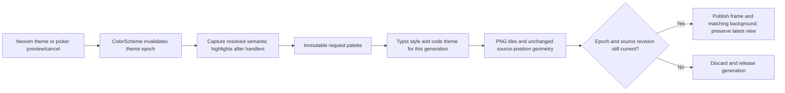

# Rich Markdown theme convergence

> Historical design/review record. The current automated suite checks source
> preservation, editor behavior, lifecycle, and public render outputs. Font- and
> pixel-dependent appearance assertions and implementation-counter checks were
> removed in the test cleanup. Use the fixture notes for visual review.

This record separates the intended experience, the selected concept, and its
implementation obligations. Native layout fixes and the synchronized rich
view are separate review commits. Theme work is a separate change. The user is away
and has explicitly delegated consequential design answers to the coordinating
agent for this pass.

## Intent and requirements

The rich reading view should feel like part of the currently selected Neovim
theme while retaining its established typography and document layout. The
source buffer remains the editing authority, and the active pane drives
navigation. Theme following applies to continuous and paginated presentation.

The coordinating agent confirmed these observable requirements:

- Page and prose colors follow the actual active editor colors, including
  resolved highlight overrides. Semantic headings, mathematics, links, panels,
  borders, and code syntax follow corresponding active roles.
- Committed theme changes, picker previews, and picker cancellation all update
  the rich view. No additional theme selector or registry is introduced.
- A color-only change preserves layout, source mapping, exact current preview
  viewport, cursor, and focus. Navigation during preparation continues; a new
  frame must preserve the latest view rather than restore an old captured one.
- A complete frame and its background are published together. The previous
  complete image/background pair remains while its replacement is prepared.
  Superseded theme work cannot publish after a newer choice.
- Authored figures keep their original colors. A light paper backing is
  acceptable for transparent figures on a dark page; its zero-inset geometry
  must be identical in light and dark layouts.

Semantic code-color agreement is the target. Exact Tree-sitter/LSP token parity
is not a requirement for Typst's independent syntax highlighter. Font family,
font size, native SVG decoding, global terminal configuration, and base-system
packages remain outside this change.

Simplicity, appropriate reuse, coherent ownership, low coupling, and a small
maintained footprint govern the choice. They are evaluation principles rather
than promises that integration requires no custom code.

## Concepts considered

| Concept | Benefit | Cost or contradiction | Decision |
| --- | --- | --- | --- |
| A generic light/dark document theme | Very small state space | Ignores actual theme accents and user overrides | Insufficient for the intent |
| A document template for each named theme | Can be individually tuned | Duplicates the theme registry and requires maintenance for every family/variant | Reject |
| Read the existing exported terminal-theme file | Reuses an existing artifact | The export intentionally omits picker previews, so it is not the current editor state | Reject as authority |
| Use only `custom.theme.palette()` | Existing normalized role names | Its cache is maintained for known themes; an unknown theme can still see the last known palette | Not used by the selected adapter |
| Snapshot live editor highlights into document roles | Honors active selection and overrides, works without another registry | Requires a small semantic adapter and render invalidation | Select |

The chosen concept composes the existing editor, document renderer, and Typst
capabilities. The editor owns active colors; an immutable snapshot supplies one
render generation; the worker owns document styling; publication owns the
visible frame/background pair. Conversion and presentation do not independently
query mutable theme state.

## Evidence and role policy

[`custom.theme`](../lua/custom/theme.lua) already owns the theme choices,
normalized palettes, and picker restoration. Its picker applies a real
colorscheme while previewing and restores the original on cancellation.
[`terminal_palette.highlights()`](../lua/custom/terminal_palette.lua) already
reads resolved semantic code groups through `nvim_get_hl` and is reusable
without introducing another theme-family mapping.

The selected adapter reads live highlights directly and derives missing-role
fallbacks from the current foreground/background. It does not use the named
palette cache at all. Capture runs in the paired source window's context;
reading from the active preview or picker can accidentally treat that window's
`winhighlight` remapping as the editor's new page color. Generator lifecycle
tests exposed that feedback path, and the adapter now receives the source window
explicitly. The selected mapping uses live `Normal` foreground/background for the document,
`Title` for headings, `SnacksImageMath` for mathematics, `Underlined` for links,
`Comment` for muted text, `NormalFloat`/`CursorLine` for panels, and
`WinSeparator` for borders, with coherent live-color fallbacks when a role is
missing. Code roles reuse the shared semantic highlight reader. The exact
fallback mapping is implementation detail, but stale cached palette values
must not override an unknown theme's actual `Normal` colors.

A read-only probe confirmed that an unknown custom theme with `Normal`
`#101820`/`#e8e4d9` could still receive a cached Tokyo Night base/text from
`custom.theme.palette()`. This is why the palette helper alone is not the
authority. The probe artifacts live under
`.test-results/markdown-view-theme-cycle-1/`.

Typst accepts a standard `.tmTheme` for syntax-token colors. Its raw-text theme
does not apply document foreground/background properties, so the document and
code-panel fills must also receive explicit roles. This reuses a standard
format rather than building a second syntax renderer.
[Typst raw-text theme documentation](https://typst.app/docs/reference/text/raw/#parameters-theme).

The page fill must be explicit: Typst's default PNG page is white, which would
otherwise survive a dark editor theme. Tile padding and the Neovim canvas
background must use the same published page color.
[Typst page fill documentation](https://typst.app/docs/reference/layout/page/#parameters-fill).

## Color fidelity and readability decision

The coordinating agent chose to preserve exact resolved semantic colors and
user overrides in this first pass. No silent contrast correction or per-theme
recoloring framework is added. Contrast measurements are review evidence, not
a promise that arbitrary user themes meet an accessibility standard.

The initial probe found body contrast of at least approximately 4.5:1 in the
sampled themes. Some accents/comments are deliberately lower contrast: Rosé
Pine Dawn title about 3.14:1, Tokyo Night Day title about 3.11:1 and comment
about 2.54:1, and Rosé Pine Main mathematics about 3.38:1. A large title and
small table heading do not have the same visual needs; these inherited theme
tradeoffs remain visible in the review rather than being silently rewritten.
Inspection identified a separate pairing problem: a custom scheme can use a
dark `Normal` with a light foreground and an inverted `NormalFloat` with a dark
foreground. Combining the document foreground with that float background makes
rich code/quotes unreadable, even though both original native pairs are legible.
The coordinating agent approved a small surface guard: if document-foreground
contrast against the proposed panel is below the smaller of 4.5:1 and the
native `Normal` pair's contrast, use the exact `Normal` background. Apply the
same principle to table headers, using heading-on-page contrast as their native
baseline. Foregrounds and syntax colors remain unchanged. This guards new
cross-pairings introduced by the adapter; it does not rewrite an inherited
low-contrast theme or user override.

## Derived implementation obligations and verification

Choosing an asynchronous color snapshot adds obligations beyond reading color
values. The invalidation epoch must advance when a colorscheme changes, before
a deferred render can race with an older result. Capture must run after other
colorscheme handlers have finalized custom highlights. Per-generation styles
and code-theme files are immutable; a shared style file must not be rewritten
while an older worker reads it.

For a color-only publication, source tick, mode, width, and terminal cell
geometry still match. Preserve the latest actual window view at publication,
including when a picker owns focus. Do not resynchronize through a coarse source
anchor merely because a new image has different colors. Closing, failure,
cancellation, generation pruning, and native renderer coexistence keep their
existing ownership rules.

Verification covers:

- The same hierarchy, equation, table, code, and figure notes in actual light
  and dark palettes, in both layouts.
- Unknown-theme and explicit-highlight overrides, plus missing-role fallback.
- Pixel role colors, authored figure colors, readable transparent-figure
  backing, and identical geometry/source anchors across color-only changes.
- A real theme preview followed by cancellation, rapid changes with forced
  stale completion, and navigation while a new frame is preparing.
- Exact viewport/cursor/focus preservation, including picker focus and hidden
  or maximized panes, and matching image/background publication.

Generated PNGs establish document output. Embedded-Neovim grid and transport
checks establish editor state and requests. Neither is presented as a captured
Ghostty pixel session.

## Independent visual and geometry review

The first review matrix rendered `07-theme-material.md` with actual live
Catppuccin Latte/Mocha, Rosé Pine Dawn/Main, Tokyo Night Day/Night, and two
unknown custom-color states, each in continuous and paginated presentation.
It then expanded to all 19 choices in the existing theme registry, without
duplicating that registry in production code. All 38 named-theme outputs and
four custom-color outputs succeeded. The unknown inverted-float state exercises
the new surface-pair guard rather than silently changing the user's foreground
colors.

The reviewer inspected light/dark code, mathematics, table headers, quotes, and
transparent figures. Page, prose, and semantic accents belong to their selected
themes. The authored dark figure labels remain readable on the light backing,
and the red signal keeps its original meaning. The figure crop's pixels were
identical across all 42 theme/layout outputs when compared within the same
layout. Exact unquantized Typst source-anchor positions also matched the
pre-theme layout baseline in all 42 outputs.

Measured body contrast ranged from approximately 4.525:1 to 14.086:1 in this
matrix. Some inherited links, accents, and comments remain lower contrast, as
the coordinating agent explicitly chose; for example, Latte's link was about
2.814:1 and Tokyo Night Day's comment about 2.537:1. The expanded matrix also
found Ayu Light title/math/comment contrast around 2.227/2.864/1.989:1 and One
Light title/math/comment around 2.987/2.883/2.311:1. These are real inherited
legibility limits, especially for small text, rather than new surface-pairing
failures. The coordinating agent reaffirmed preserving these selected colors
and reporting the tradeoff, without claiming universal legibility or silently
correcting the user's scheme.

Local review artifacts are under
`.test-results/markdown-view-theme-cycle-1/`:

- `theme-before-after-continuous.png`: fixed-light baseline versus the active
  dark theme, using the same source.
- `theme-light-dark-continuous.png` and `theme-light-dark-paged.png`: actual
  light/dark palette comparisons.
- `source-colors.json`/`all-source-colors.json` and
  `contrast.json`/`all-contrast.json`: live source-role probes and measurements.
- `visual-results.json`, `geometry.json`, and `figure-colors.json`: rendering,
  exact source-anchor geometry, and original-figure-color evidence.
- `all-theme-results.json`: all 19 existing named choices in both layouts.

The generator's automated lifecycle results remain the authority for forced
theme races, picker cancellation, focus/view preservation, and atomic
image/background publication. Visual success alone does not establish those
contracts.

## Completed automated checks

The focused theme suite passed all 17 cases in
`.test-results/run-o90nkth_/results.xml`. It includes the real ThemePicker
preview/cancel path, late worker results, the synchronous/deferred invalidation
gap, source-window color authority, manual highlight refresh, latest view/focus
preservation, hidden restoration, failure/retry behavior, and source edits during
a theme render. Raster checks inspect actual semantic code glyphs with bounded
antialias tolerance, rather than merely finding colors in the palette file.

The combined Markdown run passed 134 checks with one explicit strict expected
failure in `.test-results/run-xcf6f0ad/results.xml`. That expected failure is the
previously documented native prose-adjacent display-math case, not a theme
failure. The fast suite passed 64 checks in
`.test-results/run-3ablht4q/results.xml`; selected suites overlap. Plugin
revisions matched the committed lockfile, and StyLua/Python syntax/whitespace
checks passed.

Tests and probes use isolated editor state/cache, retaining installed dependency
data only where required. The real-picker artifact records unchanged source
hashes, exact view/focus snapshots, no persisted cancelled selection, unchanged
real-user theme-state hashes during the case, and monitored subprocesses. The
implementation reads source highlights and writes only render-generation files;
it neither selects a theme nor exports terminal configuration.
