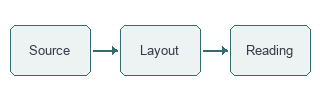

# Figures with a purpose

A compact diagram should remain compact. A wide figure should fit the reading
area. Neither should stretch beyond its natural size merely because it is an
image, and captions should explain the figure without dominating it.

## A small local figure

The small diagram above has a natural width of 320 pixels. Compare its scale
with the prose, rather than judging only whether an image appeared.

## A wider local figure

The wider figure has a natural width of 960 pixels. It should scale down when
needed, preserve its aspect ratio, and leave a useful relation to its caption.

## Obsidian-style local attachment

![[assets/compact-diagram.png]]

The same underlying figure should not acquire a radically different scale just
because the source uses a different local embed syntax.

## Failed assets do not erase surrounding prose

This final sentence is a recovery marker: it must remain readable even when
the two preceding assets cannot be displayed.
