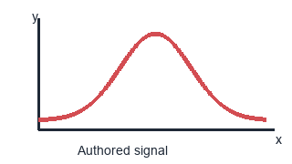

# One document, one selected theme

The page and prose should belong to the selected editor theme. **Emphasis**,
inline mathematics $x^2+y^2$, and a [visible link](https://example.com/reading)
should remain distinct and readable.

## Mathematical contrast

$$
p(x)=\frac{1}{\sigma\sqrt{2\pi}}\exp\left(-\frac{(x-\mu)^2}{2\sigma^2}\right)
$$

The mathematical accent should follow the editor's resolved math highlight,
while preserving the equation's alignment and geometry.

> **A quiet panel.** Backgrounds and borders should explain structure without
> competing with the text. This quotation also checks contrast in a nested block.

| Role | Expectation |
| --- | --- |
| Prose | A readable foreground on the page background. |
| Header | A distinct surface and a clear heading colour. |
| Mathematics | The selected mathematical accent, with no colour-only reflow. |

## Code belongs to the same palette

```python
def scale_measurement(value=42):
    message = "preserve strings"
    # Comments should remain quieter than executable content.
    return value * 2
```

## Authored figure colours remain data



The figure keeps its original colours in both light and dark themes. A light
paper backing makes its dark labels legible without inverting its pixels or
changing what the red curve means.

## A stable place to return

Move to this passage in the reading pane, scroll a few rows, and switch themes.
The current passage, cursor column, viewport, and active pane should stay where
you put them. A temporary theme-picker preview and its cancellation should both
update the rich view without changing the Markdown source.
